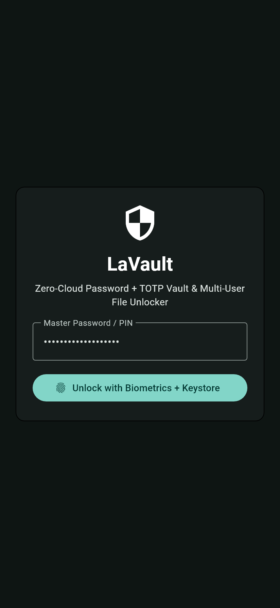
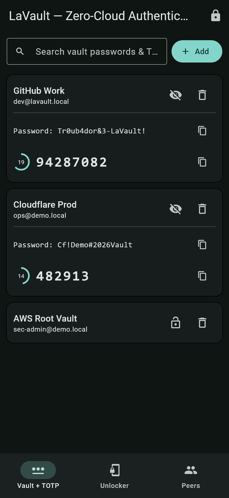
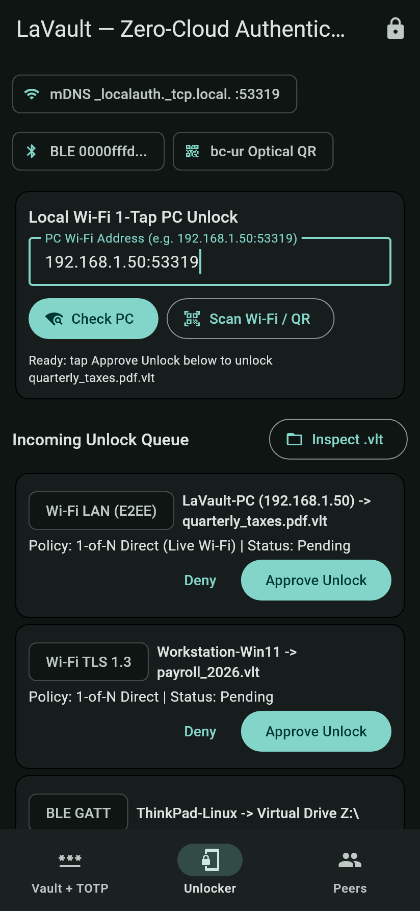
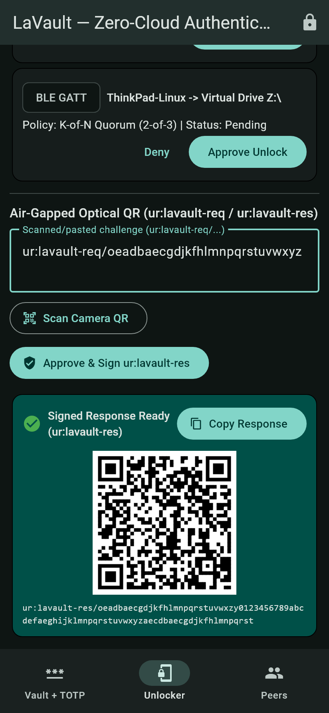
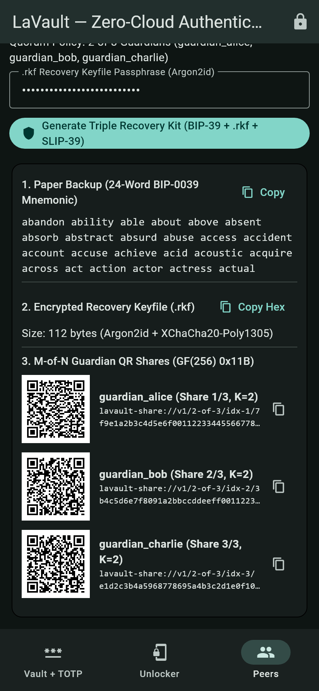
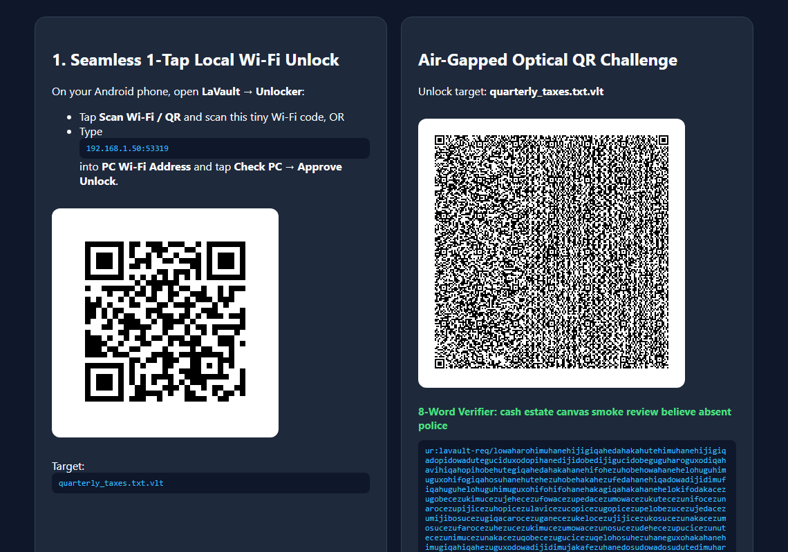
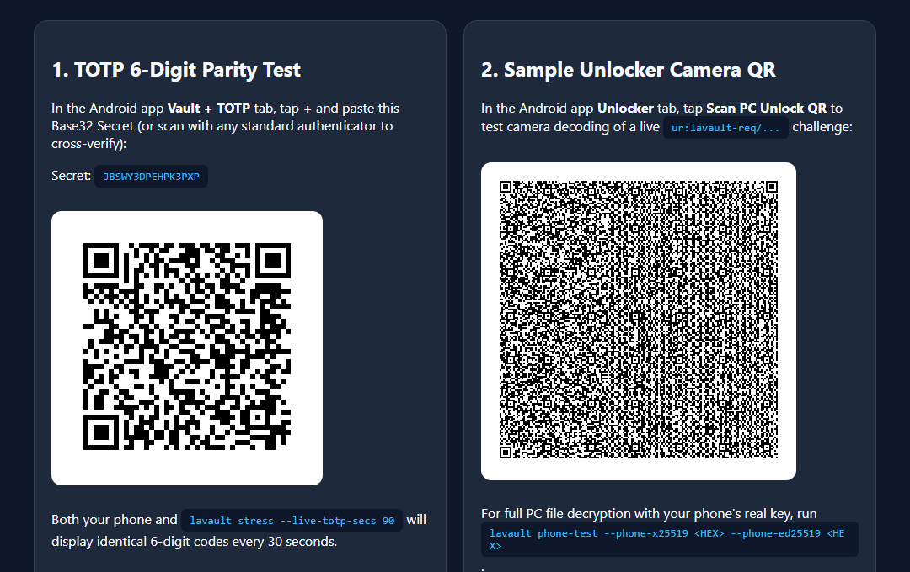
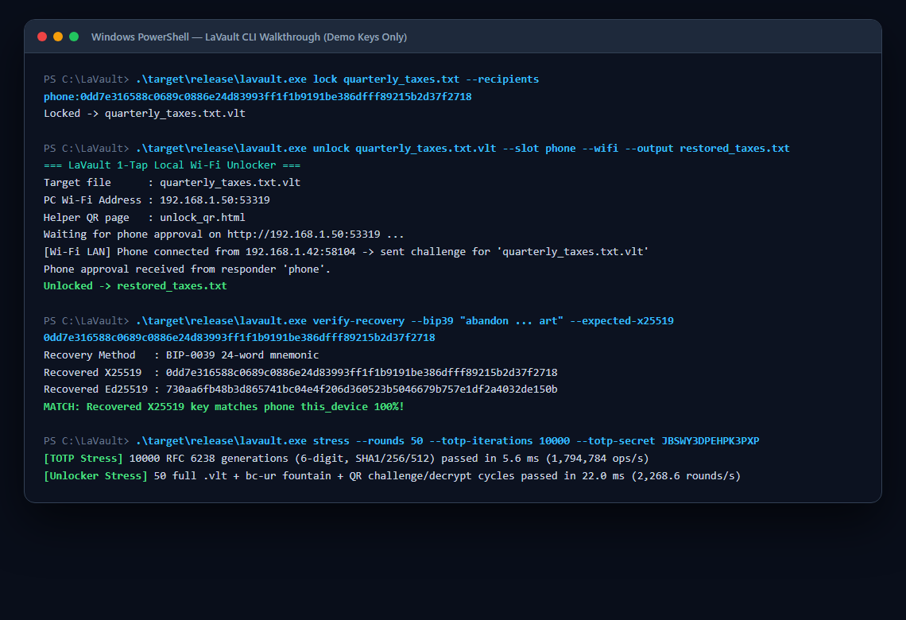

# LaVault

**Zero-Cloud Local Mobile Authenticator, Password + Live TOTP Vault, and Multi-User File & Virtual Volume Unlocker** built in Rust + Flutter (`flutter_rust_bridge`).

- **Live Feature Showcase (GitHub Pages):** https://lauyeehow1986-hub.github.io/LAVault/
- **Downloads (GitHub Releases):** https://github.com/lauyeehow1986-hub/LAVault/releases/latest
  - **Android Mobile App (`lavault-android.apk`):** Biometrics/AndroidKeyStore vault, live 6/7/8-digit TOTP codes, 1-tap LAN Wi-Fi approval, air-gapped camera QR scanner, and Triple Recovery exporter.
  - **Windows Desktop (`lavault-windows-x64.zip`):** Contains `app_flutter.exe`, `vault_core.dll`, and the `lavault.exe` CLI (`lock`, `unlock --wifi`, `verify-recovery`, `stress`, `phone-test`).
  - **Linux CLI (`lavault-cli-linux-x64.tar.gz`):** `lavault` CLI binary.

---

## Feature Screenshots

| Biometric Lock Screen | Vault + Live TOTP | 1-Tap LAN Wi-Fi Unlocker | Air-Gapped Optical QR |
| :---: | :---: | :---: | :---: |
|  |  |  |  |

| Triple Recovery Kit (Mobile) | PC Wi-Fi &amp; QR Helper (`unlock_qr.html`) | 3-Way TOTP Parity (`stress_qr.html`) | PowerShell CLI Walkthrough |
| :---: | :---: | :---: | :---: |
|  |  |  |  |

---

## Step-by-Step Usage Guides

First, unlock **LaVault** on your Android phone, open the **`Peers`** tab (3rd tab), and tap the copy icon next to **`this_device`** to copy your phone's persistent 64-character **X25519 public key**.

### 1. Lock & Unlock a File or Folder

```powershell
# Lock a file for your phone (and keep an owner key slot)
.\lavault.exe lock my_secrets.txt --recipients phone:<PHONE_X25519_HEX>

# Or lock an entire folder into a compressed .dir.vlt container
.\lavault.exe lock .\my_folder --output my_folder.dir.vlt --recipients phone:<PHONE_X25519_HEX>

# Unlock via offline optical QR (scan unlock_qr.html in Unlocker -> Scan Camera QR, then paste ur:lavault-res/...)
.\lavault.exe unlock my_secrets.txt.vlt --slot phone --output restored_secrets.txt
.\lavault.exe unlock my_folder.dir.vlt --slot phone --dir --output .\restored_folder
```

### 2. Seamless 1-Tap Local Wi-Fi Unlocker (No Copy-Paste)

With your PC and phone on the same Wi-Fi network:

1. Start the PC LAN unlock listener:
   ```powershell
   .\lavault.exe unlock my_secrets.txt.vlt --slot phone --wifi --output restored_secrets.txt
   ```
   PowerShell prints your **`PC Wi-Fi Address`** (e.g. `192.168.1.50:53319`), a tiny `lavault-wifi://...` terminal QR, and writes **`unlock_qr.html`**.
2. On Android **`Unlocker`**: tap **`Scan Wi-Fi / QR`** (or enter `192.168.x.x:53319` and tap **`Check PC`**).
3. Tap **`Approve Unlock`** on the incoming **`Wi-Fi LAN (E2EE)`** card — your phone unwraps the DEK inside Rust FFI and POSTs the encrypted `ur:lavault-res/...` response straight to your PC, which decrypts `restored_secrets.txt` immediately.

### 3. Triple Recovery Verification & 3-Way TOTP Sync

#### Verify Triple Recovery Backups Against Your Phone
In the Android **`Peers`** tab, tap **`Generate Triple Recovery Kit (BIP-39 + .rkf + SLIP-39)`**, then verify all 3 backup methods on PC:

```powershell
# 1) 24-word BIP-39 mnemonic
.\lavault.exe verify-recovery --bip39 "word1 word2 ... word24" --expected-x25519 <PHONE_X25519_HEX>

# 2) Encrypted Argon2id .rkf keyfile hex
.\lavault.exe verify-recovery --rkf-hex <RKF_HEX> --rkf-pass "Recovery-Keyfile-Pass#2026" --expected-x25519 <PHONE_X25519_HEX>

# 3) Any 2 of 3 Shamir Guardian QR shares
.\lavault.exe verify-recovery --shares "<SHARE_1_URI>" "<SHARE_3_URI>" --expected-x25519 <PHONE_X25519_HEX>
```

Each prints **`MATCH: Recovered X25519 key matches phone this_device 100%!`**.

#### 3-Way TOTP Sync & Stress Benchmark

```powershell
# Run 10,000 TOTP generations + 50 .vlt/bc-ur fountain benchmarks + 120s live ticker & QR sheet
.\lavault.exe stress --rounds 50 --totp-iterations 10000 --live-totp-secs 120 --qr-html-out stress_qr.html
```

Open **`stress_qr.html`** to scan the secret into Google/Microsoft Authenticator, add **`JBSWY3DPEHPK3PXP`** in LaVault Android (`+` button), and compare live 6-digit codes ticking identically across all three devices.

#### Direct Interactive Phone QR Stress Test

```powershell
.\lavault.exe phone-test --phone-x25519 <PHONE_X25519_HEX> --iterations 5
```

---

## Architecture

- **`crates/vault_core/`** — Shared Rust cryptographic core (`zeroize`, Argon2id RFC 9106, HKDF-SHA256, X25519, Ed25519, RFC 4226/6238 HOTP/TOTP, SQLite + XChaCha20-Poly1305 vault with persistent `vault_meta:master_seed`, `LAVAULT1` CBOR `.vlt` 1-of-N & K-of-N Shamir GF(256) `0x11B` containers, 64 KB STREAM encryption, 32 KB overlay VFS + XTS-AES-256, BIP-39 / `.rkf` / Guardian recovery, `bc-ur`, SPAKE2, `flutter_rust_bridge` API).
- **`crates/desktop_daemon/`** — Desktop CLI (`lock`, `unlock --wifi`, `mount`, `recipients add/remove`, `pair`, `stress`, `phone-test`, `verify-recovery`), LAN E2EE HTTP unlock server (with HTTP/1.1 chunked `Transfer-Encoding` support), mDNS (`_localauth._tcp.local.:53319`) + pinned mutual Ed25519 TLS 1.3, `btleplug` BLE GATT, optical QR + SVG HTML generator, and virtual volume manager.
- **`app_flutter/`** — Unified Flutter 3-tab app (`Vault + TOTP`, `Unlocker`, `Peers`) with `local_auth`, `flutter_secure_storage`, direct Android `MethodChannel` storage resolution, and camera QR scanner (`mobile_scanner`).
- **`docs/`** — Static GitHub Pages showcase site and real feature screenshots.
- **`mcp/mcp_vault_dev_server.py`** — FastMCP verification server (`--self-test`).

## Local Verification Commands

```bash
python3 mcp/mcp_vault_dev_server.py --self-test
cargo test --workspace
cargo build --workspace --release
cd app_flutter && flutter analyze && flutter test
```
